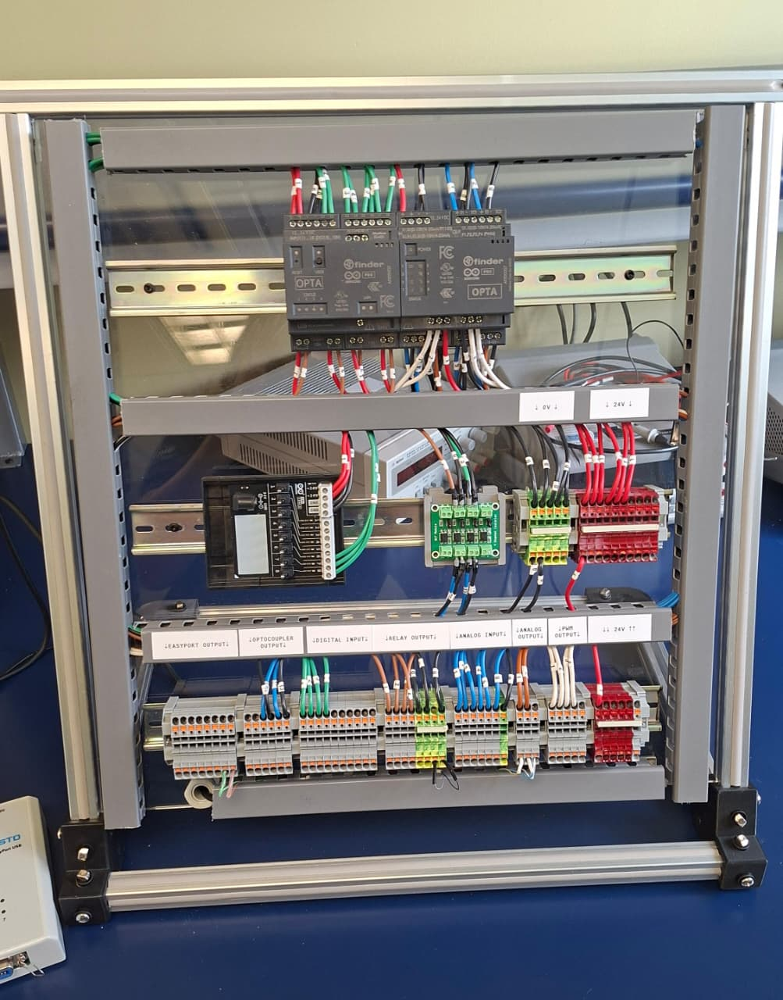
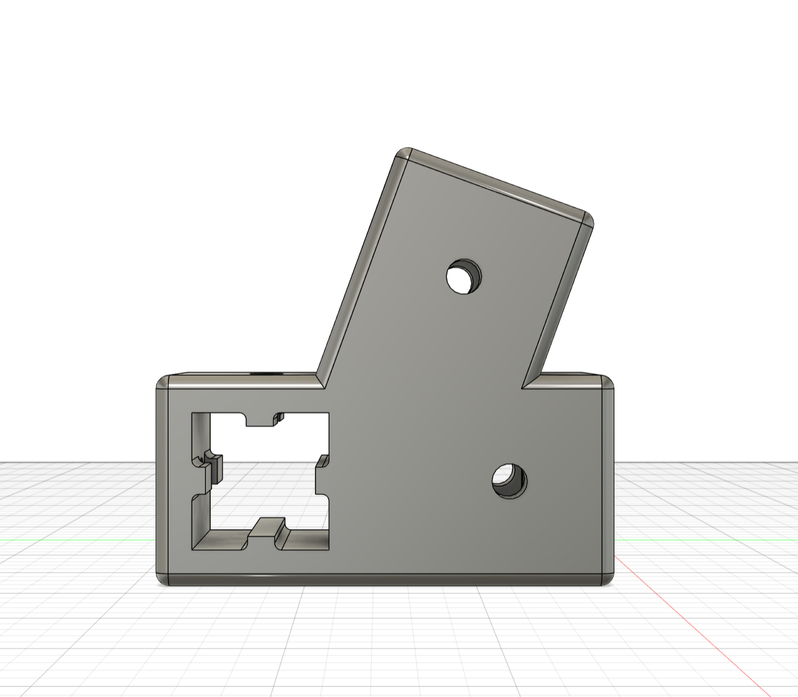
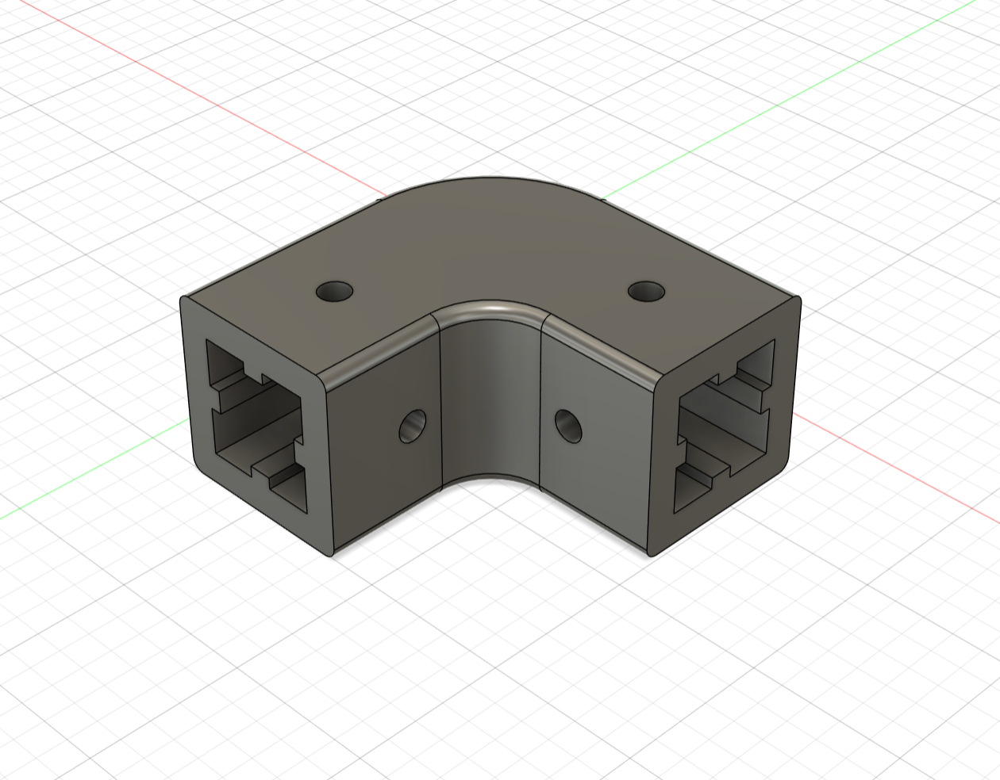

# Plataforma didáctica de automatización industrial con PLC

Trabajo Final de Graduación de la carrera de Ingeniería Electrónica, Instituto Tecnológico de Costa Rica, Campus Tecnológico Local San Carlos.

**Diseño de una plataforma didáctica para la enseñanza de PLC de la Escuela de Ingeniería Electrónica del Campus Tecnológico Local San Carlos**

- Autora: María del Milagro Rojas Sánchez



## Resumen

El programa de Ingeniería Electrónica del Campus Tecnológico Local San Carlos del ITCR carecía de una plataforma propia para la enseñanza práctica de automatización con PLC.

Se diseñó y construyó una plataforma didáctica modular basada en el Arduino Opta WiFi, el kit AKX00051 y el módulo analógico AFX00007, montada en un panel de control con riel DIN sobre una estructura de perfil de aluminio T-slot. Una regleta de borneras identificadas, con cableado codificado por tipo de señal, permite conectar los dispositivos de campo sin intervenir el hardware de control, y una tarjeta optoacopladora PC817 permite accionar circuitos propios del estudiante a la tensión que requieran, entre 3,6 y 30 V. Dos prácticas en Ladder Diagram, documentadas en una guía de laboratorio, validaron la entrada digital, la salida de relé, la entrada y la salida analógicas y la salida PWM.

## Contenido del repositorio

| Carpeta | Contenido |
|---|---|
| [`entregables/`](entregables) | Informe final, guía de laboratorio para el estudiante y presentación de la defensa, en PDF |
| [`diagramas/`](diagramas) | Diagrama eléctrico de la plataforma, diagramas de las prácticas 1 y 2, plano del panel de control y diagrama de la metodología, en PDF y en su fuente de draw.io |
| [`piezas/`](piezas) | Piezas de unión diseñadas para la estructura, arandela de corte láser y modelo de ensamble |
| [`hardware/`](hardware) | Fotografías de la plataforma, hoja de datos del DIN Celsius y fotografías de los cables del EasyPort |
| [`practicas/`](practicas) | Proyectos de FluidSIM y ejemplos realizados en el banco de trabajo |
| [`latex/`](latex) | Código fuente LaTeX del informe, de la guía y de la presentación, con sus imágenes |

## Entregables

- [Informe final](entregables/Informe_Final_TFG.pdf). Se omite la página de la declaratoria de autenticidad.
- [Guía de laboratorio para el estudiante](entregables/Guia_PLC_Estudiante.pdf). Incluye la configuración de FluidSIM y del EasyPort y las dos prácticas paso a paso.
- [Presentación de la defensa](entregables/Presentacion_Defensa.pdf).

## Hardware de la plataforma

| Elemento | Descripción |
|---|---|
| Arduino Opta WiFi (kit AKX00051) | Micro PLC programable con los lenguajes de IEC 61131-3 en el Arduino PLC IDE. 8 entradas de 0 a 24 V DC y 4 salidas de relé |
| Módulo analógico AFX00007 (A0602) | Entradas y salidas analógicas de 0 a 10 V y salidas PWM, conectado al Opta por el bus AUX. Requiere su propia alimentación de 12 a 24 V DC |
| DIN Simul8 (kit AKX00051) | Ocho interruptores para simular entradas digitales y bloque de distribución de 24 V |
| DIN Celsius (kit AKX00051) | Sensor de temperatura de prueba con salida de 0 a 10 V y dos calentadores. Se usa fuera del panel |
| Tarjeta optoacopladora PC817 de 4 canales | Acopla las salidas de 24 V con circuitos del estudiante de 3,6 a 30 V |
| Festo EasyPort USB (D16A) | Enlaza la plataforma física con la planta virtual de FluidSIM y lee la salida analógica |
| Estructura | Seis perfiles de aluminio T-slot 20x20 mm de 500 mm, cuatro piezas de unión impresas en PLA y panel de acrílico inclinado a 70° |

El cableado sigue un código de colores por tipo de señal: rojo para +24 V (etiqueta 1), negro para 0 V (etiqueta 0), verde para entradas digitales, café para salidas de relé, azul para entradas analógicas, marrón-naranja para salidas analógicas y blanco para PWM. Cada hilo lleva una etiqueta con el número de su canal.

El presupuesto total de la plataforma es de ₡478.780,42. El detalle y la comparación de costos con un PLC Siemens S7-1500 y con el Festo EduTrainer están en el Apéndice A y en la Sección 5.4 del informe.

## Piezas diseñadas

Las uniones inferiores de la estructura no se resuelven con las escuadras normalizadas del sistema T-slot, porque en ellas concurren tres perfiles y uno llega inclinado a 70°. Por eso se diseñaron en Autodesk Fusion 360 cuatro piezas de unión propias, impresas en PLA:

- Dos piezas delanteras con angulación de 70°, que unen el larguero de la base, el soporte lateral y el montante del panel.
- Dos codos traseros, para las esquinas posteriores de la base.

| Pieza delantera (vista lateral) | Codo trasero |
|---|---|
|  |  |

Plan de corte de la perfilería (seis perfiles de 500 mm):

| Elemento | Longitud final | Perfiles de origen | Requiere corte |
|---|---|---|---|
| Montantes inclinados a 70° | 500 mm | 2 | No |
| Largueros longitudinales de la base | 500 mm | 2 | No |
| Soportes laterales inferiores | 250 mm | 1 (seccionado a la mitad) | Sí |
| Soporte trasero | 435 mm | 1 (recortado 6,5 cm) | Sí |

## Diagramas

- [Diagrama eléctrico de la plataforma](diagramas/pdf/Diagrama_Electrico_Plataforma.pdf)
- [Diagrama eléctrico de la Práctica 1](diagramas/pdf/Diagrama_Electrico_Practica1.pdf)
- [Diagrama eléctrico de la Práctica 2](diagramas/pdf/Diagrama_Electrico_Practica2.pdf)
- [Plano del panel de control](diagramas/pdf/Plano_Panel_Control.pdf)
- [Diagrama de la metodología](diagramas/pdf/Diagrama_Metodologia.pdf)

Las fuentes `.drawio` se abren en [app.diagrams.net](https://app.diagrams.net). El diagrama eléctrico de la plataforma (hoja 2) y el de la Práctica 1 (hoja 3) están en el mismo archivo, `Diagrama_Electrico_Plataforma.drawio`.

## Prácticas de laboratorio

1. **Práctica 1. Secuencia de cinco estados.** Programa en Ladder que gobierna un cilindro simulado en FluidSIM. Las entradas llegan desde pulsadores y las salidas de relé del Opta se leen en FluidSIM a través del EasyPort.
2. **Práctica 2. Sistema de enfriamiento con ventilación regulable.** El DIN Celsius representa un recinto que se calienta. El controlador lee la temperatura por la entrada analógica, regula un ventilador con la salida PWM y envía la señal de control al EasyPort por la salida analógica.

El procedimiento paso a paso de ambas prácticas está en la [guía de laboratorio](entregables/Guia_PLC_Estudiante.pdf). Los proyectos de FluidSIM están en [`practicas/fluidsim/`](practicas/fluidsim).

## Manuales y hojas de datos

Las hojas de datos de Arduino se publican con licencia CC BY-SA 4.0. Los manuales de Festo y del Arduino PLC IDE tienen derechos reservados, por lo que no se incluyen en el repositorio y se indican sus fuentes.

| Documento | Fuente |
|---|---|
| Arduino Opta, hoja de datos (AFX00001, AFX00002, AFX00003) | [docs.arduino.cc](https://docs.arduino.cc/resources/datasheets/AFX00001-AFX00002-AFX00003-datasheet.pdf) |
| Módulo analógico AFX00007, hoja de datos | [docs.arduino.cc](https://docs.arduino.cc/resources/datasheets/AFX00007-datasheet.pdf) |
| Arduino PLC Starter Kit AKX00051, hoja de datos | [docs.arduino.cc](https://docs.arduino.cc/resources/datasheets/AKX00051-datasheet.pdf) |
| DIN Celsius ABX00098, hoja de datos | [incluida](hardware/datasheets/ABX00098-datasheet.pdf), también en [docs.arduino.cc](https://docs.arduino.cc/resources/datasheets/ABX00098-datasheet.pdf) |
| Manual de usuario del Opta | [docs.arduino.cc](https://docs.arduino.cc/tutorials/opta/user-manual/) |
| Manual del Arduino PLC IDE | Se instala con el Arduino PLC IDE, en la carpeta `Docs` del programa |
| Festo EasyPort USB, manual (ref. 721876, ed. 10/2011) | Festo Didactic |
| Cable de E/S con conector SysLink, hoja de datos (ref. 380156) | Festo Didactic, [página del producto](https://www.festo.com/mx/es/p/cable-de-datos-de-i-o-con-conector-syslink-en-un-lado-id_PROD_DID_167122) |
| FluidSIM | [Festo](https://www.festo.com/us/en/e/technical-education/digital-learning/virtual-simulation-and-modeling/fluidsim-id_1663056) |

La asignación de hilos del cable SysLink y del cable analógico Sub-D 15 del EasyPort, con los colores verificados en el banco, está en la Sección 1.3 de la guía de laboratorio. Las fotografías de los cables están en [`hardware/easyport_cables/`](hardware/easyport_cables).

## Compilar los documentos

Los documentos se compilan con `pdflatex` (MiKTeX o TeX Live) desde la carpeta [`latex/`](latex):

```
pdflatex Documento_TFG.tex        (2 pasadas)
pdflatex Presentacion_Defensa.tex (2 pasadas)
cd Guía_Estudiante
pdflatex Guia_PLC_Estudiante.tex  (3 pasadas)
```

El informe incluye la guía como Apéndice B. Antes de compilarlo, copie `entregables/Guia_PLC_Estudiante.pdf` a `latex/Guia_PLC_Estudiante_TFG.pdf`. La firma de la declaratoria no se publica, por lo que esa página se compila sin ella.
